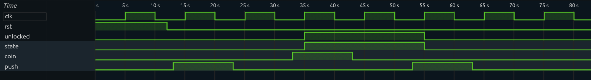

# Turnstile Controller (Verilog)

A simple 2-state turnstile FSM: inserting a coin unlocks it, pushing through locks it again.

## Behavior

| Input            | Current state | Next state |
|------------------|---------------|------------|
| coin             | any           | UNLOCKED   |
| push (no coin)   | UNLOCKED      | LOCKED     |
| push (no coin)   | LOCKED        | LOCKED     |
| no input         | any           | unchanged  |

`unlocked = 1` means the turnstile is open. After reset it starts LOCKED.
If `coin` and `push` are high at the same time, `coin` has priority.

## How it works

One state bit holds the turnstile state. The next state is `coin | (state & ~push)`. The output depends only on the state register, so it changes only on a clock edge.

## Waveform

The testbench pushes while locked (nothing happens), inserts a coin (it unlocks), then pushes (it locks again).

## Files

- `rtl/turnstile.v`: the design
- `tb/tb_turnstile.v`: testbench

## How to run

1. Open [EDA Playground](https://edaplayground.com) and select **Icarus Verilog**.
2. Paste `turnstile.v` into the design window and `tb_turnstile.v` into the testbench window.
3. Enable **Open EPWave after run**, then press **Run**.

## What I learned

(Write 2-3 sentences in your own words.)
